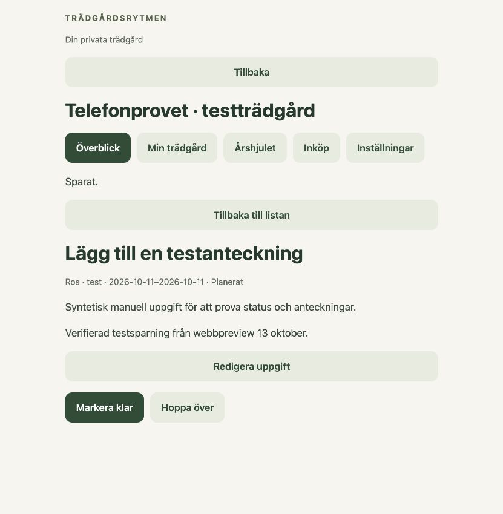

# Trädgårdsplanerare: privat telefonprov

Förberett 2026-10-13 från main `7082264`, separat arbetskopia
`tradgardsrytmen-phone-test`, gren `task/planner-phone-test`.
Expo-projektets namn/ägare enligt användaren: `@jockeoh/tradgardsplanerare`.
Detta kör hela nya appen i Expo Go. Det är ännu inte en fristående
App Store-/TestFlight-installation. Telefonprovet är påbörjat men inte slutfört.

## Öppna på iPhone

1. Installera Expo Go och logga in som `jockeoh`. Tailscale ska vara på.
2. Logga in Expo CLI på Macen med samma konto. Dubbelklicka
   `Logga in i Expo.command`, eller kör från `mobile/`:
   `EXPO_NO_TELEMETRY=1 node node_modules/expo/bin/cli login --browser`.
   Lösenordet ska bara anges i Expos eget inloggningsflöde.
3. När testsessionen kör: skanna QR-koden med iPhones kamera och öppna i Expo Go.
   Adressen på denna Mac är `exp://100.100.87.11:8083`.
4. I appen används det separata testkontot `kim`, inte Expo-kontot.
   Testlösenordet skrivs i startterminalen och finns i
   `.tmp-data/phone-test/credentials.json` (filen är privat och Git-ignorerad).
   Välj **Telefonprovet · testträdgård**.


Förifylld API-adress:
`https://joakims-macbook-pro.tail197480.ts.net:18443`.
QR-koden gäller just denna Mac; startprogrammet visar aktuell adress vid ny start.
Macen behöver vara vaken och ansluten till Tailscale under provet.

## Starta igen och stoppa

Dubbelklicka `Starta telefontest.command` eller kör från projektroten:

```sh
.venv/bin/python scripts/start_phone_test.py
```

Startprogrammet läser Macens Tailscale-adress, kontrollerar att portarna är
lediga, återanvänder testdata och startar API + Expo. Ctrl-C stoppar båda
processerna. Testdata och den privata HTTPS-proxyn finns kvar.
En tidigare aktiv testsession måste stoppas före en ny start.

Tailscale Serve använder en egen port 18443 och ändrar inte andra tjänster.
För att ta bort enbart testproxyn:

```sh
/Applications/Tailscale.app/Contents/MacOS/Tailscale serve --https=18443 off
```

På en ny arbetskopia behövs Python 3.12 och Node enligt `mobile/package.json`:

```sh
python3.12 -m venv .venv
.venv/bin/python -m pip install -r requirements.txt
cd mobile
npm ci
```

## Det finns att prova

- Överblick, Min trädgård, Årshjulet, Inköp och Inställningar.
- Tre växter och två områden i huvudträdgården, öppna uppgifter och historik.
- Ros med aktiv plan och rosmarin med en uppgift vid behov.
- Hallon med ett tydligt märkt syntetiskt planförslag att granska/godkänna.
- En andra trädgård för kontot `kim`; kontot `alex` har bara huvudträdgården.
- Inköpslista och jordberäkning börjar utan gamla privata inköpsdata.

Första telefonrundan: öppna växt → ändra en anteckning → klarmarkera en
uppgift → kontrollera historik → granska hallonplanen → prova inköp och
jordberäkning → stäng/öppna appen och kontrollera att sparningarna finns kvar.
Prova därefter nätavbrott och omstart under sparning; kontrollera befintligt
kvitto innan en oklar handling upprepas.

## Avgränsning och verifiering

SQLite-filen är separat, märkt som testinstallation och bevaras vid omstart.
Inga produktionsdata läses. Oväntad eller omdirigerad databas avvisas.
AI, OIDC, push och utgående serveranslutningar är avstängda. Planförslagen är
syntetiska så att granskning kan provas utan riktig AI. Verklig analys och
notisleverans ingår inte i detta prov. Expo saknar fortfarande PWA:ns läsbara
offlinearbetslista; ett sparat skrivförsök innebär inte full offlinefunktion.

Kontroller den 13 oktober: 72 mobiltester, typkontroll/lint, riktigt
HTTP-/processomstartsprov, fyra tester för testinstallationens isolering och
bevarade data samt iOS-bundling. Privat HTTPS-hälsa och Metro över Tailscale
svarar. Riktig browserinloggning via Tailscale HTTPS, öppning av hela workspace
och sparning/återläsning av anteckning är verifierade. Ett upptäckt browserfel
i standardtransportens fetch-anrop är rättat med två regressionsprov.
Inloggning och öppning av trädgården har nu nåtts på fysisk iPhone. Där
upptäcktes ett renderingsfel i växtens skötselplan: ett löst mellanslag utanför
Text. Felet är rättat, med regressionstest för aktiv, väntande och saknad plan;
testet reproducerade felet före rättningen. Hela telefonrundan efter rättningen
och verklig notisleverans är inte verifierade.



Expos [inloggningskrav för fysisk iPhone](https://docs.expo.dev/troubleshooting/expo-go-sign-in-required/)
kräver samma konto i Expo Go och CLI. Vid första CLI-inloggning kan **Try Again**
räcka på telefonen; vid kontobyte startas Expo-servern om.

Testdatabasen ska aldrig användas i den vanliga serverns release eller backup.
